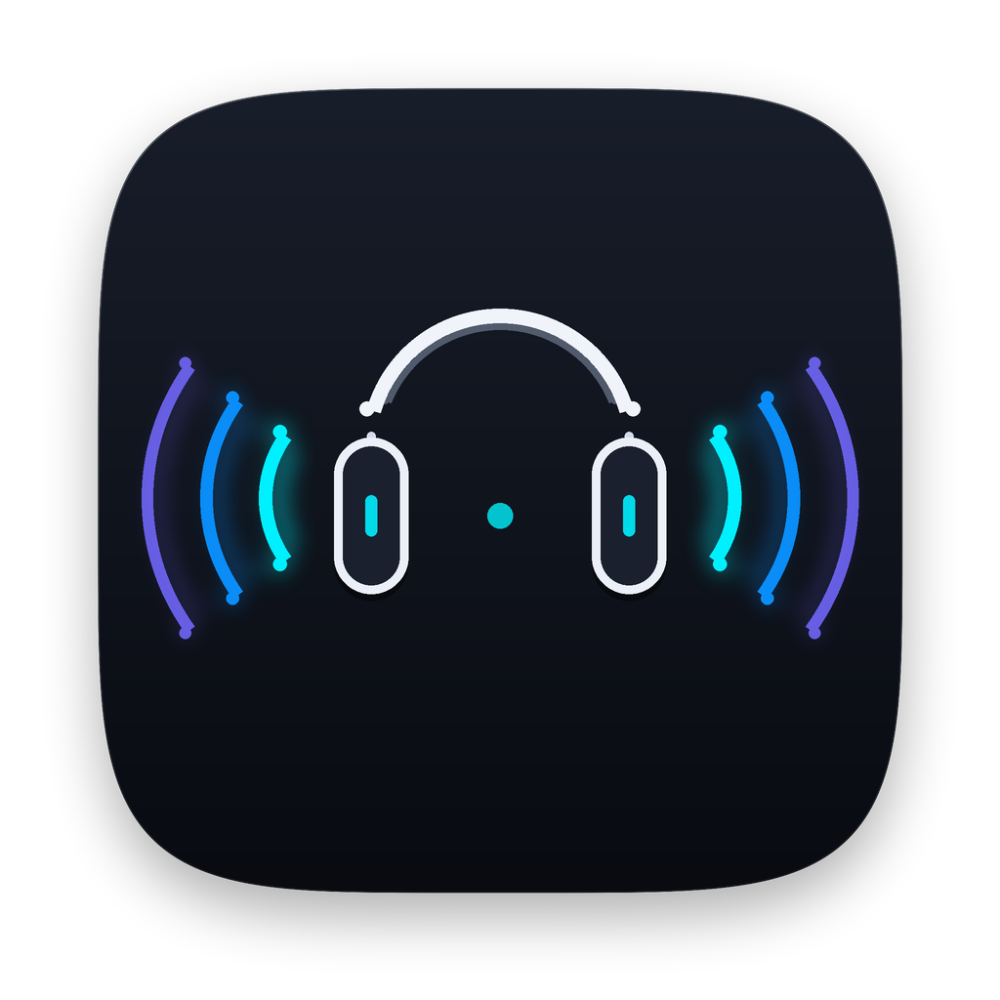
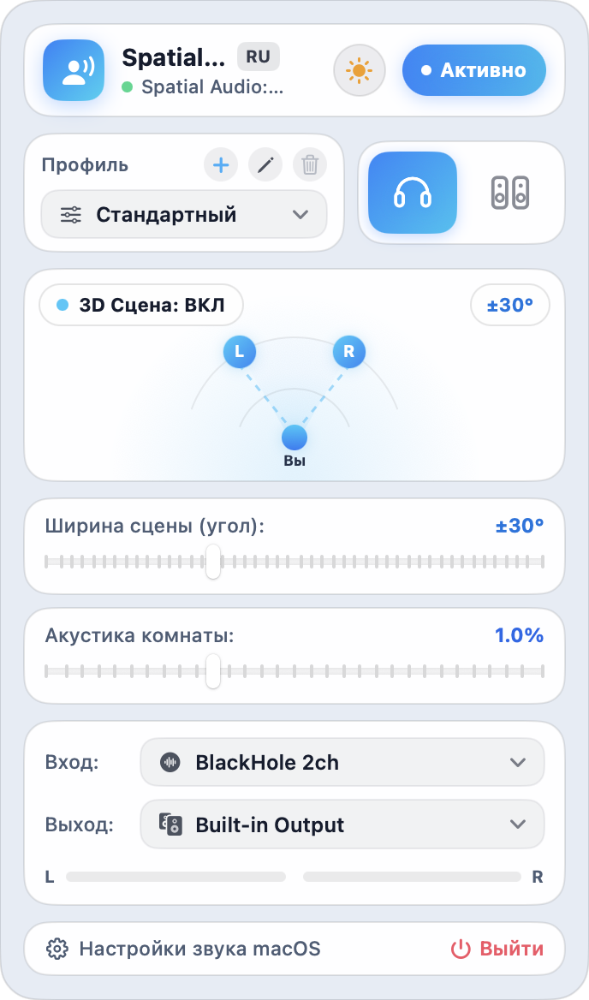

<div align="center">



# SpatialAudio for macOS

**System-wide Apple HRTFHQ Spatial Soundstage & Speaker Virtualization for ANY Headphones & Speakers on Mac**  
*Нативное пространственное стерео (Apple HRTFHQ + XTC Speaker Mode) для любых наушников и колонок в macOS*

[](https://github.com/vladsboev-web/SpatialAudio/releases)
[-success?logo=apple)](https://github.com/vladsboev-web/SpatialAudio/releases)
[](https://github.com/vladsboev-web/SpatialAudio/releases)
[](#-acoustic-engineering--dsp-architecture)
[-brightgreen)](https://github.com/vladsboev-web/SpatialAudio/releases/latest)

<br/>



<br/>

[**🇺🇸 English**](#-english) · [**🇷🇺 Русский**](#-русский) · [**📦 Download / Скачать**](https://github.com/vladsboev-web/SpatialAudio/releases/latest)

</div>

---

## 🇺🇸 English

### Why SpatialAudio?

By default, macOS restricts Apple's Spatial Audio to AirPods and Beats hardware, while standard stereo in headphones creates an unnatural sensation where sound is trapped directly inside your head (*"in-head localization"*). Long listening sessions cause severe lateral ear fatigue.

When listening through laptop speakers or closely spaced desktop monitors, the opposite problem occurs: the narrow physical stereo base causes cross-talk between ears, collapsing soundstage depth and smearing instrumental separation.

**SpatialAudio v2.0** is a native, ultra-lightweight Swift Menu Bar utility (<1% CPU, zero Electron bloat) that unlocks Apple's official **`HRTFHQ` (High-Quality Head-Related Transfer Function)** 3D audio engine for **any** headphones — Sony, Bose, Sennheiser, Beyerdynamic, wired IEMs, USB DACs, or AirPods — and introduces an acoustic **Stereo Speaker XTC Mode** that expands the stereo field beyond physical speaker boundaries.

---

### 🔬 Acoustic Engineering & DSP Architecture

Binaural 3D rendering and speaker virtualization involve complex psychoacoustics. SpatialAudio v2 solves the three fundamental acoustic challenges of spatial audio:

#### 1. 7-Band Diffuse-Field Equalization (`StereoFeed`)
Apple's native `kAudioUnitSubType_SpatialMixer` HRTF model is based on an acoustic dummy head that introduces fixed mechanical resonances:
* Main ear canal resonance: $+1.42\text{ dB}$ around $2.26\text{ kHz}$.
* Concha / pinna cavity resonance: $+4.35\text{ dB}$ peak at $7.31\text{ kHz}$ (causing harsh sibilance and treble fatigue).
* Dummy head high-frequency resonance: $+5.60\text{ dB}$ at $12.6\text{ kHz}$ and $+1.75\text{ dB}$ at $12.75\text{ kHz}$ (total $-7.43\text{ dB}$ dip needed).

SpatialAudio v2 implements a precision **7-band Diffuse-Field EQ** in Double-precision floating point (`Direct Form II Transposed` biquads). It eliminates the dummy head's static frequency coloration while strictly preserving the directional **Blauert band** ($3.5 - 4.5\text{ kHz}$) and personal anatomical pinna notches.

| Band | Filter Type | Frequency $f_c$ | $Q$ | Gain | Acoustic Purpose |
| :---: | :---: | :---: | :---: | :---: | :--- |
| **Band 1** | Peaking EQ | $1\,230\text{ Hz}$ | $0.77$ | $-0.43\text{ dB}$ | Smooth transition into midrange plateau |
| **Band 2** | Peaking EQ | $2\,260\text{ Hz}$ | $1.70$ | $-1.42\text{ dB}$ | Ear canal resonance compensation |
| **Band 3** | Peaking EQ | $3\,530\text{ Hz}$ | $4.50$ | $-0.97\text{ dB}$ | Step smoothing while protecting Blauert band ($4-4.5\text{ kHz}$) |
| **Band 4** | Peaking EQ | $7\,310\text{ Hz}$ | $2.98$ | $-4.35\text{ dB}$ | Complete elimination of concha resonance & sibilants |
| **Band 5** | Peaking EQ | $10\,340\text{ Hz}$ | $4.50$ | $+0.65\text{ dB}$ | Slope decoupling between $7.3\text{ kHz}$ and $12.6\text{ kHz}$ |
| **Band 6** | Peaking EQ | $12\,600\text{ Hz}$ | $2.07$ | $-5.60\text{ dB}$ | Treble dummy head resonance removal |
| **Band 7** | Peaking EQ | $12\,750\text{ Hz}$ | $3.00$ | $-1.75\text{ dB}$ | Target dip matching spherical average ($-7.43\text{ dB}$ total) |

#### 2. Adaptive Mid-Channel Center Restoration (Phantom Center Dip)
When virtual stereo monitors are placed in front of you ($\pm 15^\circ \dots \pm 60^\circ$), identical Left and Right signals ($M = (L+R)/2$) arrive at both ears with an Interaural Time Difference ($\text{ITD} \approx 250-300\mu\text{s}$). This produces destructive comb filtering with deep notches ($-6 \dots -11\text{ dB}$) in the central vocal range ($1.2 - 3.2\text{ kHz}$).

SpatialAudio v2 dynamically isolates the Mid channel and applies an **Adaptive Bell Filter** with cosine-spline interpolation across angles $15^\circ \to 60^\circ$ ($3\,050\text{ Hz} \to 610\text{ Hz}$, $Q = 1.10 \to 0.68$, Gain $+3.2 \dots +3.8\text{ dB}$). Dialogue, movie speech, and lead vocals stay centered, solid, and intelligible without hollow phase cancellation.

#### 3. Low-Frequency Reverb Compensation (`.smallRoom`)
CoreAudio's `.smallRoom` reverb model introduces acoustic phase cancellation at $46\text{ Hz}$ ($-2\text{ dB}$ sub-bass loss) and a boxy resonance at $82\text{ Hz}$ and $235\text{ Hz}$. SpatialAudio v2 applies dynamic real-time compensation:
* $46\text{ Hz}$ Peaking: $+2.45\text{ dB} \times (1 - e^{-\text{pct}/0.55})$ (restores deep sub-bass impact).
* $82\text{ Hz}$ Peaking: $-0.28\text{ dB} \times \text{pct}$ (eliminates boomy boxiness).
* $235\text{ Hz}$ Peaking: $-0.45\text{ dB} \times \text{pct}^{0.72}$ (clears lower-mid muddiness).

#### 4. Stereo Speakers XTC Mode (Blumlein/Bauer Shuffler)
When listening on physical MacBook or external desktop speakers, HRTF binaural processing is bypassed to prevent double ear-filtering. Instead, the signal is routed through a Blumlein/Bauer M/S shuffler:
* Side channel ($S = (L-R)/2$) High-Shelf filter above $250\text{ Hz}$ ($Q = 0.707$) with gain up to $+3.5\text{ dB}$ calculated dynamically from physical speaker angle $\theta_{\text{phys}} \in [\pm 10.0^\circ \dots \pm 35.0^\circ]$:
  $$G_{\text{Side}} = 20\log_{10}\left(\frac{\sin 30^\circ}{\sin \theta_{\text{phys}}}\right) \in [0.0 \dots +3.5\text{ dB}]$$
* Bass below $200\text{ Hz}$ and mono signals ($L+R = 2M$) remain strictly $1:1$ bit-exact.
* Early room reflections are fed $100\%$ wet with equal-power scaling ($\text{sendScale} = 0.65\sqrt{\text{reverbBlend}}$).

#### 5. BS.1770 LUFS Equal Loudness Gain Staging
Bypass and Spatial modes are calibrated to identical ITU-R BS.1770 integrated loudness ($0\text{ LU}$ difference, $preGain = -0.5\text{ dB}$). The Apple Peak Limiter acts purely as a transparent safety margin, guaranteeing zero dynamic compression or pumping.

#### 6. Sub-Sample RingBuffer & Single Attenuation Volume
* **Clock Drift Tracking**: A lock-free ring buffer with continuous linear interpolation and $\pm 0.8\%$ clock drift auto-tracking eliminates buffer underruns between the Mac host and Bluetooth DACs.
* **Single Attenuation (1:1 Unity Gain)**: Volume keys (`F10`/`F11`/`F12`) adjust the audio stream once inside BlackHole. This preserves the native logarithmic curve, prevents double attenuation ($V^2$), and eliminates Bluetooth AVRCP volume ceiling bugs.

---

### ✨ Key Features in v2.0

- **🎧 Two Dedicated Audio Modes**:
  - **Headphones Mode (`HRTFHQ`)**: Apple binaural mixer with calibrated 7-band Diffuse-Field EQ and Adaptive Mid-EQ.
  - **Speakers Mode (XTC M/S Shuffler)**: Physical speaker angle adjustment ($\pm 10.0^\circ \dots \pm 35.0^\circ$) widening the soundstage beyond the laptop screen.
- **🎨 Liquid Glass UI**:
  - Borderless `FloatingControlPanel` (`NSPanel`) with 120 Hz CoreAnimation slide & fade transitions from the Menu Bar.
  - Custom vector icons for Headphones, Speakers, and Theme toggle.
  - Persistent **Light / Dark Theme** switcher (initializes from macOS system appearance on first launch) and instant **RU / EN** language switching.
  - Real-time audio-reactive radial gradient waves rising strictly beneath UI cards in sync with L/R level meters ($0\%$ CPU when closed).
- **💾 Independent Profile Management (CRUD)**: Separate profile lists for Headphones and Speakers modes with automatic "Default" profile creation.
- **🔄 Smart Hot-Plug & Media Control**:
  - Connect/disconnect headphones without losing `BlackHole 2ch` as macOS default output.
  - Two-phase Bluetooth stream discovery prevents coreaudiod crashes.
  - System media auto-pauses during device transitions and auto-resumes once playback is ready.

---

### 📦 Installation

#### Option A: 1-Command via Homebrew (Recommended)
```bash
brew install --cask vladsboev-web/tap/spatialaudio
```

#### Option B: Manual Installation
1. **Install BlackHole 2ch** (Virtual loopback driver):
   ```bash
   brew install blackhole-2ch
   ```
2. **Download SpatialAudio**:
   - Download `SpatialAudio.zip` from [Releases](https://github.com/vladsboev-web/SpatialAudio/releases/latest).
   - Unzip and drag `SpatialAudio.app` to `/Applications`.
3. **Bypass macOS Gatekeeper on first launch**:
   ```bash
   xattr -cr /Applications/SpatialAudio.app
   open /Applications/SpatialAudio.app
   ```
4. **Grant Microphone Permission** when prompted (required by CoreAudio to capture BlackHole loopback).

---

### 🎛 Quick Start & Everyday Usage

You rarely need to open the app window during everyday listening:
1. **To listen with Spatial Soundstage**:
   - In macOS Control Center or Sound Menu Bar, select **`BlackHole 2ch`** as output. The Menu Bar icon turns solid (`person.wave.2.fill`).
2. **To bypass Spatial Audio**:
   - Select your regular speakers or headphones directly in macOS Sound menu. SpatialAudio automatically pauses ($0\%$ CPU).
3. **Right-Click the Menu Bar Icon**:
   - Instant Start / Stop toggle and Quit (`⌘Q`).

---

### 🛠 Building from Sources (Universal 2 Binary)

```bash
git clone https://github.com/vladsboev-web/SpatialAudio.git
cd SpatialAudio
./install_driver.sh
./build_app.sh
```
`build_app.sh` automatically compiles native binaries for both **Apple Silicon (`arm64`)** and **Intel (`x86_64`)**, links them into a **Universal 2 fat binary** with `lipo`, signs the app, packages `SpatialAudio.zip`, and installs it into `/Applications/SpatialAudio.app`.

---

### 🗂 Project Architecture (`Sources/`)

* [`Sources/SpatialEngine.swift`](Sources/SpatialEngine.swift) — Low-level CoreAudio DSP engine (`AVAudioEngine` + `kAudioUnitSubType_SpatialMixer`), 7-band Diffuse-Field EQ, Adaptive Mid-EQ, Reverb-EQ, and Speakers M/S Shuffler.
* [`Sources/SpatialControlView.swift`](Sources/SpatialControlView.swift) — SwiftUI Liquid Glass interface: interactive soundstage radar, vector icons, custom dropdown menus, and audio-reactive gradient waves.
* [`Sources/AudioCoordinator.swift`](Sources/AudioCoordinator.swift) — High-level audio lifecycle manager: hardware listeners, two-phase Bluetooth discovery, hot-plug routing, and profile synchronization.
* [`Sources/AudioDeviceHelper.swift`](Sources/AudioDeviceHelper.swift) — CoreAudio HAL wrapper for device discovery, volume control, data source tracking, and `MediaRemote` media control.
* [`Sources/RingBuffer.swift`](Sources/RingBuffer.swift) — Lock-free sub-sample circular ring buffer with continuous linear interpolation and $\pm 0.8\%$ clock-drift tracking.
* [`Sources/AudioCaptureUnit.swift`](Sources/AudioCaptureUnit.swift) — Zero-copy HAL AUHAL audio input capture from `BlackHole 2ch`.
* [`Sources/MenuBarController.swift`](Sources/MenuBarController.swift) — Menu Bar status item controller and borderless `FloatingControlPanel` (`NSPanel`) with 120 Hz GPU slide animation.
* [`Sources/ProfileManager.swift`](Sources/ProfileManager.swift) — Persistent JSON profile storage for Headphones and Speakers modes in `UserDefaults`.
* [`Sources/LocalizationManager.swift`](Sources/LocalizationManager.swift) — Dynamic RU / EN localization manager and `ThemeManager` with system theme detection.
* [`Sources/main.swift`](Sources/main.swift) — Application lifecycle entry point.

---

## 🇷🇺 Русский

### Зачем нужен SpatialAudio?

По умолчанию Apple ограничивает пространственный звук наушниками AirPods и Beats. Обычные проводные или Bluetooth-наушники воспроизводят стандартное стерео с неестественной изоляцией каналов (*«звук внутри головы»*), вызывая быстрое утомление слуха при прослушивании музыки или просмотре фильмов.

На динамиках ноутбука или настольных колонках возникает обратная проблема: узкая стереобаза и перекрёстные помехи между ушами схлопывают глубину сцены, делая панораму плоской.

**SpatialAudio v2.0** — это легковесная нативная утилита для macOS (<1% CPU, без Electron), которая открывает оригинальный бинауральный 3D-движок Apple **`HRTFHQ` (Head-Related Transfer Function High Quality)** для **любых наушников** (Sony, Bose, Sennheiser, Beyerdynamic, AirPods, ЦАП) и добавляет специальный **Режим колонок (Speakers XTC)** для акустического расширения стереопанорамы.

---

### 🔬 Психоакустика и калибровка звука в v2.0

Бинауральный рендеринг требует точной математической компенсации. SpatialAudio v2 решает три ключевые физические проблемы пространственного аудио:

#### 1. 7-полосный Diffuse-Field EQ (Устранение окраса манекена Apple)
В ядре CoreAudio бинауральный алгоритм Apple HRTFHQ построен на замерах физического манекена, который вносит паразитные резонансы:
* Резонанс слухового канала: $+1.42\text{ dB}$ на $2.26\text{ кГц}$.
* Резонанс ушной раковины (concha): $+4.35\text{ dB}$ на $7.31\text{ кГц}$ (вызывает резкость и «песок» на сибилянтах).
* ВЧ-пик имитатора уха: $+5.60\text{ dB}$ на $12.6\text{ кГц}$ и $+1.75\text{ dB}$ на $12.75\text{ кГц}$ (требует суммарного среза $-7.43\text{ dB}$).

В SpatialAudio v2 встроен **7-полосный каскад параметрических биквад-фильтров** высокой точности (`Double`), устраняющий стационарные пики манекена без затрагивания слуховой **полосы Блауэрта** ($3.5 - 4.5\text{ кГц}$) и индивидуальных вырезов ушной раковины.

| Полоса | Тип фильтра | Частота $f_c$ | $Q$ | Усиление | Назначение |
| :---: | :---: | :---: | :---: | :---: | :--- |
| **Band 1** | Peaking EQ | $1\,230\text{ Гц}$ | $0.77$ | $-0.43\text{ dB}$ | Плавный вход в среднечастотный диапазон |
| **Band 2** | Peaking EQ | $2\,260\text{ Гц}$ | $1.70$ | $-1.42\text{ dB}$ | Компенсация главной моды слухового канала |
| **Band 3** | Peaking EQ | $3\,530\text{ Гц}$ | $4.50$ | $-0.97\text{ dB}$ | Сглаживание ступеньки с сохранением полосы Блауэрта ($4-4.5\text{ кГц}$) |
| **Band 4** | Peaking EQ | $7\,310\text{ Гц}$ | $2.98$ | $-4.35\text{ dB}$ | Устранение резонанса чаши уха и сибилянтов |
| **Band 5** | Peaking EQ | $10\,340\text{ Гц}$ | $4.50$ | $+0.65\text{ dB}$ | Развязка склонов между $7.3$ и $12.6\text{ кГц}$ |
| **Band 6** | Peaking EQ | $12\,600\text{ Гц}$ | $2.07$ | $-5.60\text{ dB}$ | Снятие ВЧ-резонанса манекена |
| **Band 7** | Peaking EQ | $12\,750\text{ Гц}$ | $3.00$ | $-1.75\text{ dB}$ | Суммарный целевой срез до $-7.43\text{ dB}$ |

#### 2. Адаптивный Mid-EQ центра (Устранение провала голоса и диалогов)
При расстановке виртуальных мониторов под углом $\pm 15^\circ \dots \pm 60^\circ$ идентичный центральный моно-сигнал ($M = (L+R)/2$) доходит до обоих ушей с межушной задержкой ($\text{ITD} \approx 250-300\mu\text{с}$). Возникает гребенчатая интерференция: провал на $-6 \dots -11\text{ dB}$ в зоне $1.2 - 3.2\text{ кГц}$, из-за чего голос отдаляется и звучит пусто.

SpatialAudio v2 выделяет канал $M$ и применяет **адаптивный колокольный фильтр** с плавной косинусной сплайн-интерполяцией по углу ($3\,050\text{ Гц} \to 610\text{ Гц}$, $Q = 1.10 \to 0.68$, подъем $+3.2 \dots +3.8\text{ dB}$). Вокал и речь остаются плотными, разборчивыми и сфокусированными по центру.

#### 3. Reverb-EQ (Компенсация суб-баса 46 Гц в пространственной комнате)
Заводской пресет Apple `.smallRoom` при наложении отражений вызывает интерференционный спад на $46\text{ Гц}$ ($-2\text{ dB}$ суб-баса) и комнатный гул на $82\text{ Гц}$ и $235\text{ Гц}$. SpatialAudio v2 динамически компенсирует этот эффект пропорционально ползунку акустики комнаты:
* $46\text{ Гц}$ Peaking: $+2.45\text{ dB} \times (1 - e^{-\text{pct}/0.55})$ (возвращает плотный глубокий суб-бас).
* $82\text{ Гц}$ Peaking: $-0.28\text{ dB} \times \text{pct}$ (убирает коробочный резонанс).
* $235\text{ Гц}$ Peaking: $-0.45\text{ dB} \times \text{pct}^{0.72}$ (очищает нижнюю середину от мути).

#### 4. Режим колонок (Stereo Speakers XTC / Blumlein-Bauer Shuffler)
При выводе на встроенные динамики Mac или настольные стереоколонки бинауральная обработка HRTF отключается, чтобы не накладывать фильтры ушных раковин на физические динамики. Вместо этого сигнал обрабатывается через M/S-расширитель Бауэра:
* В канале $S = (L-R)/2$ работает фильтр High-Shelf выше $250\text{ Гц}$ ($Q = 0.707$) с подъемом до $+3.5\text{ dB}$, рассчитываемым по физическому полууглу колонок $\theta_{\text{phys}} \in [\pm 10.0^\circ \dots \pm 35.0^\circ]$:
  $$G_{\text{Side}} = 20\log_{10}\left(\frac{\sin 30^\circ}{\sin \theta_{\text{phys}}}\right) \in [0.0 \dots +3.5\text{ dB}]$$
* Бас ниже $200\text{ Гц}$ и моно-составляющая ($L+R = 2M$) остаются абсолютно неизменными ($1:1$).
* Ранние отражения комнаты подаются со $100\%$ wet по закону равной мощности ($\text{sendScale} = 0.65\sqrt{\text{reverbBlend}}$).

#### 5. Выравнивание громкости по LUFS (ITU-R BS.1770)
Уровень громкости режимов Bypass и Spatial выровнен до единого воспринимаемого значения ($0\text{ LU}$, $preGain = -0.5\text{ dB}$). Вы слышите реальное пространственное расширение сцены, а не психоакустический эффект «то, что громче, звучит лучше».

#### 6. Субдискретный буфер и Single Attenuation
* **Компенсация дрейфа часов**: безблокировочный кольцевой буфер с непрерывной субдискретной линейной интерполяцией и автоподстройкой скорости $\pm 0.8\%$ исключает щелчки и рассинхронизацию с Bluetooth-наушниками.
* **Single Attenuation (1:1 Unity Gain)**: системные клавиши `F10`/`F11`/`F12` регулируют громкость один раз внутри BlackHole без квадратичного затухания ($V^2$) и без ограничений Bluetooth AVRCP.

---

### ✨ Главные возможности версии 2.0

- **🎧 Два режима вывода**:
  - **Наушники (`HRTFHQ`)**: бинауральный 3D-звук с калиброванным 7-полосным Diffuse-Field EQ и адаптивным Mid-EQ.
  - **Колонки (`Speakers XTC`)**: настройка физического угла акустики ($\pm 10.0^\circ \dots \pm 35.0^\circ$) с расширением сцены за пределы экрана.
- **🎨 Дизайн Liquid Glass**:
  - Безрамочная панель `FloatingControlPanel` (`NSPanel`) с аппаратной 120 Гц анимацией открытия из строки меню.
  - Авторские минималистичные векторные иконки (Наушники, Колонки, Тема).
  - Поддержка **Светлой и Тёмной темы** (автоопределение системной темы при первом старте) и мгновенный выбор языка **RU / EN**.
  - Фоновые градиентные аудио-волны из нижних углов под карточками ($0\%$ CPU при закрытом окне).
- **💾 Раздельные профили для каждого режима (CRUD)**: независимые списки пресетов для Наушников и Колонок с авто-созданием профиля «Стандартный».
- **🔄 Умный Hot-Plug и контроль медиа**:
  - Автопереключение на подключенные наушники и возврат на динамики Mac с сохранением `BlackHole 2ch` в системе.
  - Двухфазная инициализация Bluetooth CoreAudio (защита от вылетов при регистрации аудиопотоков).
  - Автоматическая пауза системного медиаплеера при смене устройств и авто-возобновление после старта пайплайна.

---

### 📦 Установка

#### Вариант 1: В 1 команду через Homebrew (Рекомендуется)
```bash
brew install --cask vladsboev-web/tap/spatialaudio
```

#### Вариант 2: Ручная установка
1. **Установите аудиодрайвер BlackHole 2ch**:
   ```bash
   brew install blackhole-2ch
   ```
2. **Скачайте SpatialAudio**:
   - Скачайте `SpatialAudio.zip` из раздела [Releases](https://github.com/vladsboev-web/SpatialAudio/releases/latest).
   - Распакуйте и перетащите `SpatialAudio.app` в папку «Программы» (`/Applications`).
3. **Снимите карантин macOS Gatekeeper**:
   ```bash
   xattr -cr /Applications/SpatialAudio.app
   open /Applications/SpatialAudio.app
   ```
4. **Разрешите доступ к микрофону** при первом запуске (необходимо для чтения аудиопотока из BlackHole).

---

### 🎛 Руководство пользователя и сценарии

1. **Включение пространственного звука**:
   - В Пункте управления macOS или в меню Звука выберите выход **`BlackHole 2ch`**. Иконка в статус-баре станет залитой (`person.wave.2.fill`).
2. **Обычный стереозвук напрямую**:
   - Выберите динамики или наушники напрямую в меню macOS. SpatialAudio автоматически встанет на паузу ($0\%$ CPU).
3. **Правый клик по иконке в строке меню**:
   - Быстрый запуск/остановка без открытия окна и выход (`⌘Q`).

---

### 🛠 Сборка из исходников (Universal 2 бинарник)

```bash
git clone https://github.com/vladsboev-web/SpatialAudio.git
cd SpatialAudio
./install_driver.sh
./build_app.sh
```
Скрипт `build_app.sh` собирает нативный код для **Apple Silicon (`arm64`)** и **Intel (`x86_64`)**, объединяет их через `lipo` в **Universal 2 fat binary**, накладывает цифровую подпись, упаковывает релизный архив `SpatialAudio.zip` и устанавливает приложение в `/Applications/SpatialAudio.app`.

---

### 🗂 Архитектура исходного кода (`Sources/`)

* [`Sources/SpatialEngine.swift`](Sources/SpatialEngine.swift) — DSP-движок пространственной обработки CoreAudio (`AVAudioEngine` + `kAudioUnitSubType_SpatialMixer`), 7-полосный Diffuse-Field EQ, адаптивный Mid-EQ, Reverb-EQ и M/S-расширитель Бауэра для колонок.
* [`Sources/SpatialControlView.swift`](Sources/SpatialControlView.swift) — Графический интерфейс SwiftUI в стиле Liquid Glass: радар сцены, кастомные селекторы, векторные иконки и живые градиентные волны.
* [`Sources/AudioCoordinator.swift`](Sources/AudioCoordinator.swift) — Главный координатор аудиопотоков: слушатели CoreAudio HAL, двухфазная инициализация Bluetooth, сценарии горячего переключения и синхронизация профилей.
* [`Sources/AudioDeviceHelper.swift`](Sources/AudioDeviceHelper.swift) — C-API обёртка CoreAudio HAL: сканирование устройств, аппаратная громкость, распознавание data source и управление плеером через `MediaRemote`.
* [`Sources/RingBuffer.swift`](Sources/RingBuffer.swift) — Потокобезопасный кольцевой буфер с субдискретной интерполяцией и компенсацией дрейфа тактовых генераторов ($\pm 0.8\%$).
* [`Sources/AudioCaptureUnit.swift`](Sources/AudioCaptureUnit.swift) — Захват цифрового звука из `BlackHole 2ch` через низкоуровневый AUHAL без лишних аллокаций памяти.
* [`Sources/MenuBarController.swift`](Sources/MenuBarController.swift) — Элемент менюбара macOS и плавающая панель `FloatingControlPanel` (`NSPanel`) со 120 Гц аппаратной анимацией.
* [`Sources/ProfileManager.swift`](Sources/ProfileManager.swift) — Хранилище профилей настроек звуковой сцены для Наушников и Колонок в `UserDefaults`.
* [`Sources/LocalizationManager.swift`](Sources/LocalizationManager.swift) — Менеджер реактивной локализации (`RU`/`EN`) и сохранение светлой/тёмной темы (`ThemeManager`).
* [`Sources/main.swift`](Sources/main.swift) — Точка входа в приложение и перехват системного завершения.

---

### 📄 Лицензия

Распространяется под свободной лицензией [MIT License](LICENSE).
