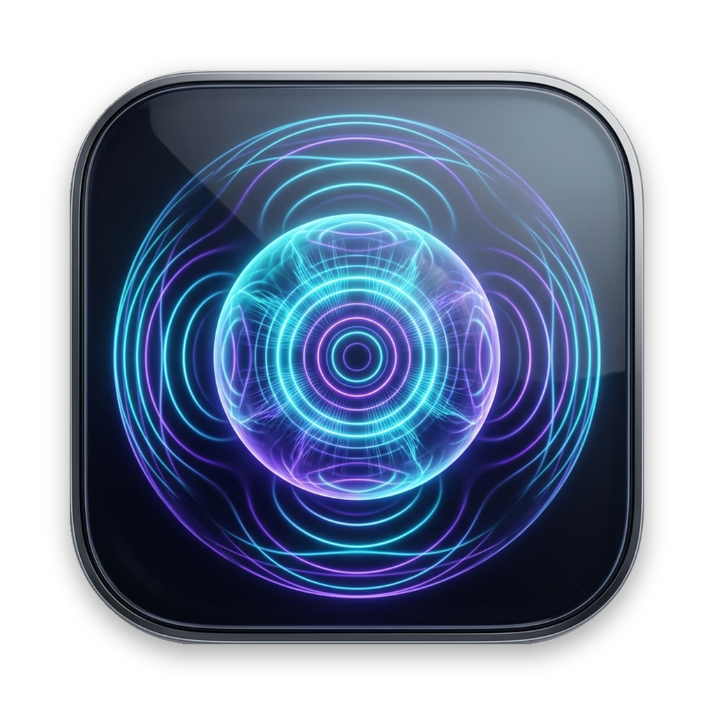

<div align="center">



# SpatialAudio for macOS

**System-wide Apple HRTFHQ Spatial Soundstage & Speaker Virtualization for ANY Headphones on Mac**  
*Нативное пространственное стерео (Apple HRTFHQ) для любых наушников в macOS*

[](https://github.com/vladsboev-web/SpatialAudio/releases)
[-success?logo=apple)](https://github.com/vladsboev-web/SpatialAudio/releases)
[](Documentation/ARCHITECTURE.md)
[-brightgreen)](https://github.com/vladsboev-web/SpatialAudio/releases/latest)

[**🇺🇸 English**](#-english) · [**🇷🇺 Русский**](#-русский) · [**📦 Download / Скачать**](https://github.com/vladsboev-web/SpatialAudio/releases/latest)

</div>

---

## 🇺🇸 English

### Why SpatialAudio?

By default, macOS restricts Apple's Spatial Audio to AirPods/Beats, while standard stereo in headphones suffers from extreme left/right channel separation (*"in-head localization"*), causing listening fatigue during long music, movie, or work sessions.

**SpatialAudio** is a lightweight, native Swift Menu Bar utility (<1% CPU, 0 Electron bloat) that unlocks Apple's official **`HRTFHQ` (High-Quality Head-Related Transfer Function)** 3D audio engine for **any** pair of headphones — whether you use Sony, Bose, Sennheiser, Beyerdynamic, wired IEMs, USB DACs, or AirPods on an Intel or Apple Silicon Mac.

It places two virtual studio monitors in front of you in 3D space, moving the soundstage **out of your head** with natural interaural time and level cues (ITD/ILD) and subtle room acoustics.

### ✨ Key Features

- **🎧 True Apple `HRTFHQ` Binaural Engine**: Uses CoreAudio's native high-quality spatial mixer (`kAudioUnitSubType_SpatialMixer` / `.HRTFHQ`) with $+4.0\text{ dB}$ binaural attenuation compensation.
- **🔊 Out-of-Head Studio Soundstage**: Adjustable speaker angle ($\pm 15^\circ \dots \pm 60^\circ$) and ultra-delicate room acoustics ($0.0\% \dots 3.0\%$ in $0.1\%$ steps) that eliminate headphone listening fatigue without coloring the tone.
- **🎚 Single Attenuation (Unity Gain 1:1) Volume Control**: Native macOS volume keys (`F10` / `F11` / `F12`) work seamlessly with a natural logarithmic curve — no double attenuation ($V^2$) and no Bluetooth AVRCP volume ceiling bugs.
- **⚡ Ultra-Low Latency & Drift-Free Audio**: Custom lock-free `AudioRingBuffer` with continuous sub-sample linear interpolation and $\pm 0.8\%$ clock-drift tracking ensures zero crackles and tight lip-sync for movies, YouTube, and gaming.
- **🔄 Smart Hot-Plug & Auto-Pause**:
  - Automatically switches to your headphones as soon as you connect them and seamlessly falls back to Mac speakers when you put them in the case.
  - Selecting another output device in macOS Control Center automatically pauses the DSP pipeline (`0% CPU`).
- **💾 Custom Profiles (CRUD)**: Create, rename, and switch between custom soundstage presets (Music, Movies, Podcasts, Gaming) saved persistently.
- **🚀 Native Universal 2 Binary**: Compiled natively for **Apple Silicon (`arm64`: M1/M2/M3/M4)** and **Intel (`x86_64`)** on macOS 13 Ventura, 14 Sonoma, and 15 Sequoia+.

### 📊 How It Compares

| Feature | Standard Stereo | Paid Audio Enhancers | **SpatialAudio** |
| :--- | :---: | :---: | :---: |
| **Soundstage** | Inside your head (L/R ear) | Artificial EQ / heavy reverb | **Natural front studio monitors (Apple HRTFHQ)** |
| **Works with ANY headphones** | ✅ | ✅ | **✅ (Bluetooth, Wired, USB DAC)** |
| **Native Apple Silicon & Intel** | ✅ | Often requires kexts/Rosetta | **✅ Pure Swift & CoreAudio (Universal 2)** |
| **CPU & RAM footprint** | 0% | High (background daemons) | **< 1% CPU, ~25 MB RAM (0% when paused)** |
| **Price & Privacy** | Free | $20–$60 / Telemetry | **100% Free & Open Source** |

### 📦 Installation (2 Minutes)

#### Step 1: Install BlackHole 2ch (Virtual Audio Loopback Driver)
SpatialAudio uses the open-source [BlackHole 2ch](https://github.com/ExistentialAudio/BlackHole) driver to capture system audio losslessly:
```bash
brew install blackhole-2ch
```
*(Or download the `.pkg` installer directly from [Existential Audio](https://existential.audio/blackhole/), or click the 1-click install button inside the app).*

#### Step 2: Download SpatialAudio
1. Download **`SpatialAudio.zip`** from the **[Latest Release](https://github.com/vladsboev-web/SpatialAudio/releases/latest)**.
2. Unzip and drag **`SpatialAudio.app`** to your `/Applications` folder.
3. **Bypass macOS Gatekeeper on first launch** (since the app is free and not notarized with a paid $99/yr Apple Developer ID):
   ```bash
   xattr -cr /Applications/SpatialAudio.app
   open /Applications/SpatialAudio.app
   ```
   *(Alternatively, Right-Click `SpatialAudio.app` in Finder → click **Open**).*
4. Grant **Microphone permission** when prompted (required by macOS CoreAudio to read the audio stream from `BlackHole 2ch`).

---

## 🇷🇺 Русский

**Нативное пространственное стерео (Apple HRTFHQ) для любых Bluetooth и проводных наушников в macOS (Fixed Spatial Audio).**

Приложение работает в строке меню (Menu Bar) macOS, перехватывает стереозвук системы через виртуальный аудиодрайвер `BlackHole 2ch`, обрабатывает его с использованием оригинального бинаурального алгоритма Apple `HRTFHQ` и выводит в ваши наушники или динамики с минимальной задержкой и идеальной синхронизацией видео и звука.

---

### 📚 Полная документация

Вся документация по архитектуре, коду, системным сценариям и истории разработки собрана в папке [Documentation/](Documentation/):

- 📖 **[Руководство пользователя (USER_MANUAL.md)](Documentation/USER_MANUAL.md)**: Установка, настройка, горячее переключение источников.
- 🏗 **[Архитектура и DSP (ARCHITECTURE.md)](Documentation/ARCHITECTURE.md)**: Математика буфера, HRTFHQ, архитектура Single Attenuation, расчет задержки.
- 📁 **[Каталог структуры проекта (PROJECT_STRUCTURE.md)](Documentation/PROJECT_STRUCTURE.md)**: Полное описание всех файлов, классов и методов.
- 🍏 **[Системная интеграция (SYSTEM_INTEGRATION.md)](Documentation/SYSTEM_INTEGRATION.md)**: CoreAudio, TCC (микрофон), сертификат разработчика.
- 📜 **[Выжимка из диалога (DIALOG_HISTORY_AND_SOLUTIONS.md)](Documentation/DIALOG_HISTORY_AND_SOLUTIONS.md)**: История решения всех багов и технических вызовов.
- 🗺 **[Дорожная карта (ROADMAP_NEXT_STEPS.md)](Documentation/ROADMAP_NEXT_STEPS.md)**: Задачи и идеи для дальнейшего развития.

---

### 🌟 Ключевые возможности

* **Apple HRTFHQ Engine**: Аппаратный бинауральный рендеринг Apple CoreAudio с компенсацией бинаурального затухания ($+4.0\text{ dB}$) — эффект сцены AirPods для любых наушников.
* **Фиксированная звуковая сцена**: Звук естественно выносится из головы вперед перед вами, как при прослушивании настоящих студийных мониторов.
* **Архитектура Single Attenuation (Unity Gain 1:1)**: Плавная и естественная регулировка громкости системными клавишами `F10` / `F11` / `F12` без эффекта двойного затухания ($V^2$) и без потолка громкости Bluetooth AVRCP.
* **Субдискретный RingBuffer**: Линейная интерполяция и автокомпенсация дрейфа тактовых генераторов ($\pm 0.8\%$) — кристально чистый звук без треска и щелчков.
* **Умное горячее переключение (Hot-Plug)**:
  - При подключении наушников звук автоматически и без скачков громкости переводится в наушники.
  - При отключении наушников (например, убрали AirPods в кейс) воспроизведение бесшовно продолжается через встроенные динамики Mac.
  - При ручном выборе другого устройства в Центре управления macOS приложение само переходит в режим паузы (`0% CPU`).
* **CRUD Профилей и тонкая акустика**: Собственные пресеты с деликатной настройкой акустики комнаты (`0.0%–3.0%` с шагом `0.1%`), сохраняемые при перезапуске.
* **Защита в полноэкранном режиме и правый клик**: Окно не обрезается при автоскрытии меню-бара, а по правому клику доступно нативное меню быстрого управления.

---

### 💻 Совместимость и системные требования

| Параметр | Поддержка / Описание |
| :--- | :--- |
| **Архитектура процессора** | **Universal 2 Binary**: Полная нативная поддержка **Apple Silicon** (`arm64`: M1, M2, M3, M4 и новее) и **Intel** (`x86_64`) |
| **Операционная система** | **macOS 13.0 (Ventura)**, **macOS 14 (Sonoma)**, **macOS 15 (Sequoia)** и новее |
| **Аудиодрайвер** | [BlackHole 2ch](https://github.com/ExistentialAudio/BlackHole) (v0.6.0+) |
| **Наушники и вывод** | Любые Bluetooth-наушники (AirPods, Sony, Bose, Sennheiser, Ugreen, Anker и др.), проводные наушники, внешние ЦАП или динамики Mac |

---

### 📦 Установка

#### Вариант 1: Быстрая установка (Готовый релиз)

1. **Установите виртуальный аудиодрайвер BlackHole 2ch** (требуется для перехвата системного звука):
   ```bash
   brew install blackhole-2ch
   ```
   *Либо скачайте официальный инсталлятор `.pkg` с [сайта Existential Audio](https://existential.audio/blackhole/) (или нажмите кнопку «Установить BlackHole в 1 клик» прямо в окне программы).*

2. **Скачайте приложение**:
   - Перейдите в раздел **[Releases](https://github.com/vladsboev-web/SpatialAudio/releases/latest)** и скачайте архив `SpatialAudio.zip`.
   - Распакуйте архив и перетащите `SpatialAudio.app` в папку `/Applications` («Программы»).

3. **Первый запуск (Обход macOS Gatekeeper)**:
   Так как приложение бесплатное и распространяется с открытым исходным кодом без платной подписки Apple Developer ID ($99/год), снимите карантин командой в Терминале:
   ```bash
   xattr -cr /Applications/SpatialAudio.app
   open /Applications/SpatialAudio.app
   ```
   *(Либо нажмите по `SpatialAudio.app` **правой кнопкой мыши** в папке «Программы» → выберите **«Открыть»**).*

4. **Доступ к микрофону**:
   При первом запуске разрешите доступ к микрофону — это необходимо macOS для чтения цифрового аудиопотока из виртуального драйвера `BlackHole 2ch`.

#### Вариант 2: Сборка из исходников (Для разработчиков)

```bash
git clone https://github.com/vladsboev-web/SpatialAudio.git
cd SpatialAudio
./install_driver.sh
./build_app.sh
```
Скрипт соберет Universal 2 бинарник (`arm64` + `x86_64`), упакует `SpatialAudio.zip` и установит подписанное приложение в `/Applications/SpatialAudio.app`.
