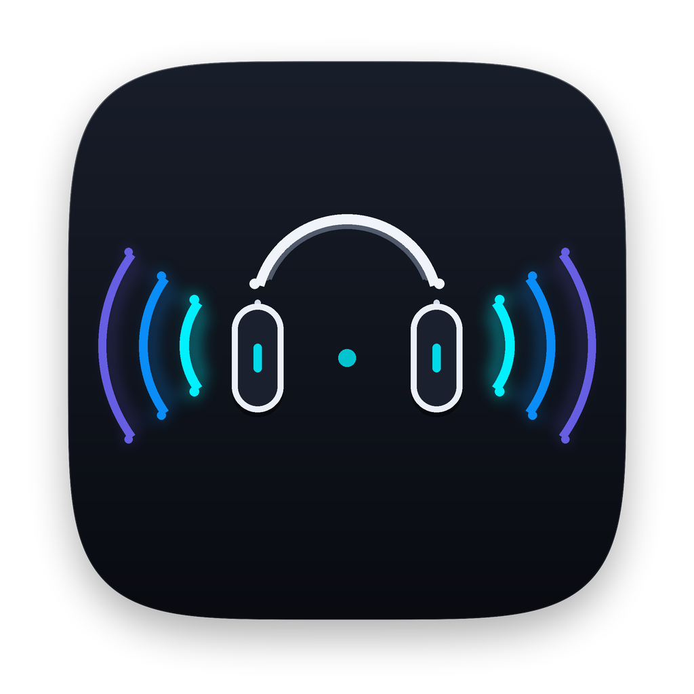
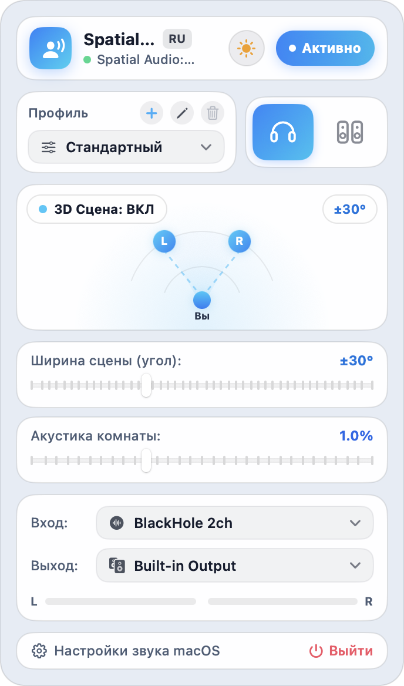

<div align="center">



# SpatialAudio for macOS

**System-wide Apple HRTFHQ Spatial Soundstage & Speaker Virtualization for ANY Headphones & Speakers on Mac**  
*Нативное пространственное стерео (Apple HRTFHQ + XTC Speaker Mode) для любых наушников и колонок в macOS*

[](https://github.com/vladsboev-web/SpatialAudio/releases)
[-success?logo=apple)](https://github.com/vladsboev-web/SpatialAudio/releases)
[](https://github.com/vladsboev-web/SpatialAudio/releases)
[](#-acoustic-engineering--dsp-architecture)
[-brightgreen)](https://github.com/vladsboev-web/SpatialAudio/releases/latest)

<br/>



<br/>

[**🇺🇸 English**](#-english) · [**🇷🇺 Русский**](#-русский) · [**📦 Download / Скачать**](https://github.com/vladsboev-web/SpatialAudio/releases/latest)

</div>

---

## 🇺🇸 English

### Why SpatialAudio?

By default, macOS restricts Apple's Spatial Audio to AirPods and Beats hardware, while standard stereo in headphones creates an unnatural sensation where sound is trapped directly inside your head (*"in-head localization"*). Long listening sessions cause severe lateral ear fatigue.

When listening through laptop speakers or closely spaced desktop monitors, the opposite problem occurs: the narrow physical stereo base causes cross-talk between ears, collapsing soundstage depth and smearing instrumental separation.

**SpatialAudio v2.0** is a native, ultra-lightweight Swift Menu Bar utility (<1% CPU, zero Electron bloat) that unlocks Apple's official **`HRTFHQ` (High-Quality Head-Related Transfer Function)** 3D audio engine for **any** headphones — Sony, Bose, Sennheiser, Beyerdynamic, wired IEMs, USB DACs, or AirPods — and introduces an acoustic **Stereo Speaker XTC Mode** that expands the stereo field beyond physical speaker boundaries.

---

### 🔬 Acoustic Engineering & DSP Architecture

Binaural 3D rendering and speaker virtualization involve complex psychoacoustics. SpatialAudio v2 solves the key physical challenges of spatial audio without distorting spatial cues:

#### 1. 13-Band Headphones Calibration (`8 Static DF-EQ + 5 Mid-EQ`)
Apple's native `kAudioUnitSubType_SpatialMixer` HRTF model is based on an acoustic dummy head and creates two distinct problems: static ear-canal resonances and a destructive phantom-center comb dip when $L = R$. At the same time, **the $3.5 - 10\text{ kHz}$ pinna localization notches and ILD cues must stay untouched** so the spatial stage does not collapse.

SpatialAudio uses a clean Double-precision (`Direct Form II Transposed`) 13-band architecture:
* **8-Band Static Diffuse-Field EQ (identical on L and R across all angles $\to 0.00\text{ dB}$ ILD/ITD loss):** eliminates dummy-head static coloration without cutting $7.3\text{ kHz}$ (zero sibilance/lisping):
  * $800\text{ Hz}$ ($Q=2.0$, $-1.22\text{ dB}$), $1\,250\text{ Hz}$ ($Q=2.2$, $+1.90\text{ dB}$), $2\,150\text{ Hz}$ ($Q=1.8$, $-2.74\text{ dB}$), $3\,150\text{ Hz}$ ($Q=2.4$, $-0.78\text{ dB}$), $4\,050\text{ Hz}$ ($Q=2.4$, $-2.36\text{ dB}$), $6\,300\text{ Hz}$ ($Q=2.5$, $-1.55\text{ dB}$), $9\,500\text{ Hz}$ ($Q=2.2$, $+1.48\text{ dB}$), $12\,650\text{ Hz}$ ($Q=2.5$, $-8.50\text{ dB}$).
* **5-Band Adaptive Mid-EQ ($560 / 880 / 1\,280 / 1\,620 / 2\,400\text{ Hz}$, $Q = 1.5 - 2.1$):** operates strictly in the Mid channel below $3\text{ kHz}$ across 19 cosine-interpolated angle nodes ($15^\circ \dots 60^\circ$), keeping Side completely untouched and restoring central voice/instrument body against ITD comb filtering.

#### 2. Delay-Aligned Dry / Wet Mix ("Effect Strength", $0\% - 100\%$)
At sample-rate setup, `SpatialEngine` runs an automatic 256-sample offline impulse calibration of `AVAudioEnvironmentNode (.HRTFHQ)` to measure Apple's exact core + resampling delay (`5` samples at $48\text{ kHz}$, `11` at $44.1\text{ kHz}$, `15` at $88.2\text{ kHz}$, `16` at $96\text{ kHz}$). A lock-free circular delay line aligns the Dry signal to the Wet signal before the Peak Limiter, enabling seamless $0\% - 100\%$ blending (`LUFS` constant within $\pm 0.05\text{ dB}$, zero comb-filter hollowness).

#### 3. 6-Tap Binaural Early Reflections ("Room Acoustics", $0\% - 100\%$ in Headphones)
Instead of a muddy long reverb tail that cancels bass, Headphones mode renders **6 physical early room reflections** ($6.7 \dots 25.3\text{ ms}$, modeled after a $4.4 \times 5.4 \times 2.7\text{ m}$ control room — strictly inside the Haas fusion window $< 30\text{ ms}$ so there is zero audible echo):
* **4th-Order Linkwitz-Riley HPF ($280\text{ Hz}$, $-24\text{ dB/oct}$)**: bass passes $1:1$ without ever entering room reflections or phase-canceling.
* **Wall HF Damping**: gentle $5.6\text{ kHz}$ / $3.4\text{ kHz}$ low-pass filtering for warm natural surfaces.
* **Angle-Coupled Geometry**: wider Stage Width ($15^\circ \to 60^\circ$) dynamically brings side-wall taps closer and increases lateral cross-ear reflections.

#### 4. Stereo Speakers XTC Mode (Band-Pass Bauer Shuffler $240 - 1\,750\text{ Hz}$)
When listening on physical MacBook or external desktop speakers, HRTF binaural processing is bypassed to prevent double ear-filtering. Instead, the signal runs through a **band-pass Blumlein/Bauer M/S shuffler**:
* Two cascaded High-Shelf filters in the Side channel ($240\text{ Hz}$ $+G$ and $1\,750\text{ Hz}$ $-G$, $Q = 0.707$) with smooth `tanh` saturation up to $+4.20\text{ dB}$ across $\theta_{\text{phys}} \in [\pm 10.0^\circ \dots \pm 35.0^\circ]$, keeping treble at $0\text{ dB}$ and bass $< 200\text{ Hz}$ / mono ($L+R = 2M$) strictly $1:1$.
* Early `.smallRoom` reflections are fed $100\%$ wet with equal-power scaling ($\text{sendScale} = 0.65\sqrt{\text{reverbBlend}}$) and 3-band low-frequency compensation ($46 / 82 / 235\text{ Hz}$).

#### 5. BS.1770 LUFS Loudness Match & End-to-End Latency
Bypass and Spatial modes are calibrated to identical ITU-R BS.1770 integrated loudness ($+0.60\text{ dB}$ makeup in Headphones, $0\text{ LU}$ match). End-to-end latency is **`42.7 - 46.4 ms`** in Bypass/Speakers and **`49.8 - 53.7 ms`** in Headphones ($48 / 44.1\text{ kHz}$) — well below lip-sync thresholds.

#### 6. Windowed-Sinc RingBuffer & Single Attenuation Volume
* **Clock Drift Tracking**: A lock-free circular ring buffer (`targetLatency = 2048` samples) with a **64-tap polyphase Kaiser windowed-sinc interpolator** (`512` phases) and $\pm 300\text{ ppm}$ clock-drift auto-tracking keeps frequency response flat to $> 21\text{ kHz}$ with zero phase drift.
* **Single Attenuation (1:1 Unity Gain)**: Volume keys (`F10`/`F11`/`F12`) adjust the audio stream once inside BlackHole. This preserves the native logarithmic curve, prevents double attenuation ($V^2$), and eliminates Bluetooth AVRCP volume ceiling bugs.

---

### ✨ Key Features in v2.0

- **🎧 Two Dedicated Audio Modes**:
  - **Headphones Mode (`HRTFHQ`)**: Apple binaural mixer with calibrated 13-band EQ (`8 DF-EQ + 5 Mid-EQ`), delay-aligned **Effect Strength (0–100% Dry/Wet)**, and clean **6-Tap Early Reflections (0–100%)**.
  - **Speakers Mode (XTC M/S Shuffler)**: Physical speaker angle adjustment ($\pm 10.0^\circ \dots \pm 35.0^\circ$) with $240 - 1\,750\text{ Hz}$ band-pass Side widening beyond physical speaker boundaries.
- **🎨 Liquid Glass UI**:
  - Borderless `FloatingControlPanel` (`NSPanel`) with 120 Hz CoreAnimation slide & fade transitions from the Menu Bar.
  - Custom vector icons for Headphones, Speakers, and Theme toggle.
  - Persistent **Light / Dark Theme** switcher (initializes from macOS system appearance on first launch) and instant **RU / EN** language switching.
  - Real-time audio-reactive radial gradient waves rising strictly beneath UI cards in sync with L/R level meters ($0\%$ CPU when closed).
- **💾 Independent Profile Management (CRUD) & Per-Device Binding**: Separate profile lists for Headphones and Speakers modes with automatic "Default" profile creation, persistent per-device memory (`UID + dataSourceID` — separating Bluetooth, USB/HDMI, built-in speakers, and 3.5 mm headphones), automatic Headphones/Speakers mode detection for new devices without overriding system volume, and a subtle `"for <Device>"` indicator in the UI.
- **🔄 Smart Hot-Plug & Media Control**:
  - Connect/disconnect headphones without losing `BlackHole 2ch` as macOS default output.
  - Two-phase Bluetooth stream discovery prevents coreaudiod crashes.
  - Automatic `AVAudioEngine` recovery on Bluetooth/AirPods format and sample-rate changes (`AVAudioEngineConfigurationChange` observer, `NominalSampleRate` listener, and 1s engine watchdog).
  - System media auto-pauses during device transitions and auto-resumes once playback is ready.

---

### 📦 Installation

#### Option A: 1-Command via Homebrew (Recommended)
```bash
brew install --cask vladsboev-web/tap/spatialaudio
```

#### Option B: Manual Installation
1. **Install BlackHole 2ch** (Virtual loopback driver):
   ```bash
   brew install blackhole-2ch
   ```
2. **Download SpatialAudio**:
   - Download `SpatialAudio.zip` from [Releases](https://github.com/vladsboev-web/SpatialAudio/releases/latest).
   - Unzip and drag `SpatialAudio.app` to `/Applications`.
3. **Bypass macOS Gatekeeper on first launch**:
   ```bash
   xattr -cr /Applications/SpatialAudio.app
   open /Applications/SpatialAudio.app
   ```
4. **Grant Microphone Permission** when prompted (required by CoreAudio to capture BlackHole loopback).

---

### 🎛 Quick Start & Everyday Usage

You rarely need to open the app window during everyday listening:
1. **To listen with Spatial Soundstage**:
   - In macOS Control Center or Sound Menu Bar, select **`BlackHole 2ch`** as output. The Menu Bar icon turns solid (`person.wave.2.fill`).
2. **To bypass Spatial Audio**:
   - Select your regular speakers or headphones directly in macOS Sound menu. SpatialAudio automatically pauses ($0\%$ CPU).
3. **Right-Click the Menu Bar Icon**:
   - Instant Start / Stop toggle and Quit (`⌘Q`).

---

### 🛠 Building from Sources (Universal 2 Binary)

```bash
git clone https://github.com/vladsboev-web/SpatialAudio.git
cd SpatialAudio
./install_driver.sh
./build_app.sh
```
`build_app.sh` automatically compiles native binaries for both **Apple Silicon (`arm64`)** and **Intel (`x86_64`)**, links them into a **Universal 2 fat binary** with `lipo`, signs the app, packages `SpatialAudio.zip`, and installs it into `/Applications/SpatialAudio.app`.

---

### 🗂 Project Architecture (`Sources/`)

* [`Sources/SpatialEngine.swift`](Sources/SpatialEngine.swift) — Low-level CoreAudio DSP engine (`AVAudioEngine` + `kAudioUnitSubType_SpatialMixer`), 13-band Headphones calibration (`8 DF-EQ + 5 Mid-EQ`), auto-calibrated Dry/Wet mix, 6-tap Early Reflections, Speakers band-pass M/S Shuffler, and `AVAudioEngineConfigurationChange` monitoring.
* [`Sources/SpatialControlView.swift`](Sources/SpatialControlView.swift) — SwiftUI Liquid Glass interface: interactive soundstage radar, vector icons, custom dropdown menus, and audio-reactive gradient waves.
* [`Sources/AudioCoordinator.swift`](Sources/AudioCoordinator.swift) — High-level audio lifecycle manager: hardware listeners, two-phase Bluetooth discovery, hot-plug routing, per-device profile synchronization, output sample-rate monitoring, and engine watchdog recovery.
* [`Sources/AudioDeviceHelper.swift`](Sources/AudioDeviceHelper.swift) — CoreAudio HAL wrapper for device discovery, persistent `DeviceUID` + `dataSourceID` profile key (`profileKey`), volume control, data source tracking, and `MediaRemote` media control.
* [`Sources/RingBuffer.swift`](Sources/RingBuffer.swift) — Lock-free sub-sample circular ring buffer with 64-tap Kaiser windowed-sinc interpolation (`512` phases) and $\pm 300\text{ ppm}$ clock-drift tracking.
* [`Sources/AudioCaptureUnit.swift`](Sources/AudioCaptureUnit.swift) — Zero-copy HAL AUHAL audio input capture from `BlackHole 2ch`.
* [`Sources/MenuBarController.swift`](Sources/MenuBarController.swift) — Menu Bar status item controller and borderless `FloatingControlPanel` (`NSPanel`) with 120 Hz GPU slide animation.
* [`Sources/ProfileManager.swift`](Sources/ProfileManager.swift) — Persistent JSON profile storage and per-device profile mapping (`deviceProfileMap`) for Headphones and Speakers modes in `UserDefaults`.
* [`Sources/LocalizationManager.swift`](Sources/LocalizationManager.swift) — Dynamic RU / EN localization manager and `ThemeManager` with system theme detection.
* [`Sources/main.swift`](Sources/main.swift) — Application lifecycle entry point.

---

## 🇷🇺 Русский

### Зачем нужен SpatialAudio?

По умолчанию Apple ограничивает пространственный звук наушниками AirPods и Beats. Обычные проводные или Bluetooth-наушники воспроизводят стандартное стерео с неестественной изоляцией каналов (*«звук внутри головы»*), вызывая быстрое утомление слуха при прослушивании музыки или просмотре фильмов.

На динамиках ноутбука или настольных колонках возникает обратная проблема: узкая стереобаза и перекрёстные помехи между ушами схлопывают глубину сцены, делая панораму плоской.

**SpatialAudio v2.0** — это легковесная нативная утилита для macOS (<1% CPU, без Electron), которая открывает оригинальный бинауральный 3D-движок Apple **`HRTFHQ` (Head-Related Transfer Function High Quality)** для **любых наушников** (Sony, Bose, Sennheiser, Beyerdynamic, AirPods, ЦАП) и добавляет специальный **Режим колонок (Speakers XTC)** для акустического расширения стереопанорамы.

---

### 🔬 Психоакустика и калибровка звука

Бинауральный рендеринг требует точной математической компенсации. SpatialAudio решает ключевые физические проблемы пространственного аудио, не разрушая признаки локализации:

#### 1. 13-полосная калибровка наушников (`8 DF-EQ + 5 Mid-EQ`)
В ядре CoreAudio бинауральный алгоритм Apple `.HRTFHQ` основан на замерах манекена и порождает две проблемы: стационарные резонансы ушного канала и глубокую гребенчатую яму в центре ($L = R$) от межушной задержки $\text{ITD}$. При этом **зона локализации ушной раковины $3.5 - 10\text{ кГц}$ и $\text{ILD}$ должны оставаться нетронутыми**, иначе сцена схлопывается в обычное стерео.

В SpatialAudio применена чистая 13-полосная архитектура с биквадами `Double`-точности (`Direct Form II Transposed`):
* **8 постоянных полос Diffuse-Field EQ (одинаковы на L и R при всех углах $\to 0.00\text{ dB}$ потерь $\text{ILD}/\text{ITD}$):** убирают резонансы манекена без провала на $7.3\text{ кГц}$ (ноль шепелявости):
  * $800\text{ Гц}$ ($Q=2.0$, $-1.22\text{ dB}$), $1\,250\text{ Гц}$ ($Q=2.2$, $+1.90\text{ dB}$), $2\,150\text{ Гц}$ ($Q=1.8$, $-2.74\text{ dB}$), $3\,150\text{ Гц}$ ($Q=2.4$, $-0.78\text{ dB}$), $4\,050\text{ Гц}$ ($Q=2.4$, $-2.36\text{ dB}$), $6\,300\text{ Гц}$ ($Q=2.5$, $-1.55\text{ dB}$), $9\,500\text{ Гц}$ ($Q=2.2$, $+1.48\text{ dB}$), $12\,650\text{ Гц}$ ($Q=2.5$, $-8.50\text{ dB}$).
* **5 адаптивных полос строго в `Mid` ($560 / 880 / 1\,280 / 1\,620 / 2\,400\text{ Гц}$, $Q = 1.5 - 2.1$):** работают ниже $3\text{ кГц}$ по 19 узлам ($15^\circ \dots 60^\circ$) с косинусной интерполяцией, не трогая боковой канал `Side` и возвращая голос/центр на фоне $\text{ITD}$-вычитания.

#### 2. Выровненный по задержке микс Dry / Wet («Сила эффекта», $0\% - 100\%$)
При инициализации `SpatialEngine` автоматически замеряет оффлайн-импульсом задержку ядра `.HRTFHQ` для текущей частоты дискретизации (`5` сэмплов @ $48\text{ кГц}$, `11` @ $44.1\text{ кГц}$, `15` @ $88.2\text{ кГц}$, `16` @ $96\text{ кГц}$). Линия задержки точно выравнивает `Dry` к `Wet` до лимитера, обеспечивая плавное смешивание $0\% - 100\%$ с ровной громкостью ($\text{LUFS} \pm 0.05\text{ dB}$) и без гребенчатого «трубного» окраса.

#### 3. 6-точечные бинауральные ранние отражения («Акустика комнаты», $0\% - 100\%$ в наушниках)
Вместо мутного эхо-хвоста, гасящего бас, в наушниках работают **6 направленных ранних отражений** комнаты ($4.4 \times 5.4 \times 2.7\text{ м}$, задержки $6.7 \dots 25.3\text{ мс}$ — внутри окна слияния Хааса $< 30\text{ мс}$, без слышимого эха):
* **ФВЧ 4-го порядка ($280\text{ Гц}$, $-24\text{ dB/окт}$)**: бас вообще не попадает в отражения и остаётся $1:1$ без провалов.
* **Поглощение ВЧ стенами**: мягкий ФНЧ $5.6\text{ кГц}$ / $3.4\text{ кГц}$ для тёплого естественного звучания.
* **Связь с шириной сцены**: расширение угла ($15^\circ \to 60^\circ$) сдвигает виртуальные колонки ближе к боковым стенам, усиливая боковые перекрёстные отражения.

#### 4. Режим колонок (Полосовой шаффлер Бауэра $240 - 1\,750\text{ Гц}$)
При выводе на встроенные динамики Mac или настольные стереоколонки бинауральная обработка HRTF отключается, а сигнал проходит через **полосовой M/S-расширитель Бауэра**:
* Две каскадные секции High-Shelf в канале $S = (L-R)/2$ ($240\text{ Гц}$ $+G$ / $1\,750\text{ Гц}$ $-G$, $Q = 0.707$) с мягким насыщением `tanh` до $+4.20\text{ dB}$ под реальный угол $\theta_{\text{phys}} \in [\pm 10.0^\circ \dots \pm 35.0^\circ]$. ВЧ остаются $0\text{ dB}$, а бас $< 200\text{ Гц}$ и моно ($L+R = 2M$) — абсолютно $1:1$.
* Хвост отражений `.smallRoom` подаётся с $100\%$ wet ($\text{sendScale} = 0.65\sqrt{\text{reverbBlend}}$) и 3-полосной НЧ-компенсацией ($46 / 82 / 235\text{ Гц}$).

#### 5. Выравнивание громкости LUFS (ITU-R BS.1770) и сквозная задержка
Уровень громкости Bypass и Spatial выровнен до единого значения ($+0.60\text{ dB}$ makeup в наушниках, $0\text{ LU}$). Сквозная задержка составляет **`42.7 - 46.4 мс`** в Bypass/Колонках и **`49.8 - 53.7 мс`** в Наушниках ($48 / 44.1\text{ кГц}$) — без видимого рассинхрона с видео.

#### 6. Полифазный RingBuffer (Windowed-Sinc) и Single Attenuation
* **Компенсация дрейфа часов**: безблокировочный кольцевой буфер (`targetLatency = 2048` сэмплов) с **64-отводным полифазным фильтром Кайзера windowed-sinc** (`512` фаз) и автоподстройкой $\pm 300\text{ ppm}$ держит АЧХ плоской $> 21\text{ кГц}$ без расхождения фазы.
* **Single Attenuation (1:1 Unity Gain)**: системные клавиши `F10`/`F11`/`F12` регулируют громкость один раз внутри BlackHole без квадратичного затухания ($V^2$) и без ограничений Bluetooth AVRCP.

---

### ✨ Главные возможности версии 2.0

- **🎧 Два режима вывода**:
  - **Наушники (`HRTFHQ`)**: бинауральный 3D-звук с 13-полосной калибровкой (`8 DF-EQ + 5 Mid-EQ`), выровненной по задержке **Силой эффекта (0–100% Dry/Wet)** и чистыми **Ранними отражениями (0–100%)**.
  - **Колонки (`Speakers XTC`)**: настройка физического угла акустики ($\pm 10.0^\circ \dots \pm 35.0^\circ$) с полосовым M/S-расширением $240 - 1\,750\text{ Гц}$ за пределы экрана.
- **🎨 Дизайн Liquid Glass**:
  - Безрамочная панель `FloatingControlPanel` (`NSPanel`) с аппаратной 120 Гц анимацией открытия из строки меню.
  - Авторские минималистичные векторные иконки (Наушники, Колонки, Тема).
  - Поддержка **Светлой и Тёмной темы** (автоопределение системной темы при первом старте) и мгновенный выбор языка **RU / EN**.
  - Фоновые градиентные аудио-волны из нижних углов под карточками ($0\%$ CPU при закрытом окне).
- **💾 Раздельные профили для каждого режима (CRUD) и привязка к устройствам**: независимые списки пресетов для Наушников и Колонок с авто-созданием профиля «Стандартный», автоматическое запоминание последнего профиля на устройство по постоянному ключу `UID + dataSourceID` (раздельно для Bluetooth, USB/HDMI, встроенных динамиков и разъёма 3.5 мм), автоопределение режима «Наушники / Колонки» для новых устройств с сохранением системной громкости и аккуратная подпись `для <Устройство>` в интерфейсе.
- **🔄 Умный Hot-Plug и контроль медиа**:
  - Автопереключение на подключенные наушники и возврат на динамики Mac с сохранением `BlackHole 2ch` в системе.
  - Двухфазная инициализация Bluetooth CoreAudio (защита от вылетов при регистрации аудиопотоков).
  - Автовосстановление `AVAudioEngine` при смене профиля/частоты дискретизации Bluetooth и AirPods (наблюдатель `AVAudioEngineConfigurationChange`, слушатель `NominalSampleRate` и сторожевой таймер).
  - Автоматическая пауза системного медиаплеера при смене устройств и авто-возобновление после старта пайплайна.

---

### 📦 Установка

#### Вариант 1: В 1 команду через Homebrew (Рекомендуется)
```bash
brew install --cask vladsboev-web/tap/spatialaudio
```

#### Вариант 2: Ручная установка
1. **Установите аудиодрайвер BlackHole 2ch**:
   ```bash
   brew install blackhole-2ch
   ```
2. **Скачайте SpatialAudio**:
   - Скачайте `SpatialAudio.zip` из раздела [Releases](https://github.com/vladsboev-web/SpatialAudio/releases/latest).
   - Распакуйте и перетащите `SpatialAudio.app` в папку «Программы» (`/Applications`).
3. **Снимите карантин macOS Gatekeeper**:
   ```bash
   xattr -cr /Applications/SpatialAudio.app
   open /Applications/SpatialAudio.app
   ```
4. **Разрешите доступ к микрофону** при первом запуске (необходимо для чтения аудиопотока из BlackHole).

---

### 🎛 Руководство пользователя и сценарии

1. **Включение пространственного звука**:
   - В Пункте управления macOS или в меню Звука выберите выход **`BlackHole 2ch`**. Иконка в статус-баре станет залитой (`person.wave.2.fill`).
2. **Обычный стереозвук напрямую**:
   - Выберите динамики или наушники напрямую в меню macOS. SpatialAudio автоматически встанет на паузу ($0\%$ CPU).
3. **Правый клик по иконке в строке меню**:
   - Быстрый запуск/остановка без открытия окна и выход (`⌘Q`).

---

### 🛠 Сборка из исходников (Universal 2 бинарник)

```bash
git clone https://github.com/vladsboev-web/SpatialAudio.git
cd SpatialAudio
./install_driver.sh
./build_app.sh
```
Скрипт `build_app.sh` собирает нативный код для **Apple Silicon (`arm64`)** и **Intel (`x86_64`)**, объединяет их через `lipo` в **Universal 2 fat binary**, накладывает цифровую подпись, упаковывает релизный архив `SpatialAudio.zip` и устанавливает приложение в `/Applications/SpatialAudio.app`.

---

### 🗂 Архитектура исходного кода (`Sources/`)

* [`Sources/SpatialEngine.swift`](Sources/SpatialEngine.swift) — DSP-движок пространственной обработки CoreAudio (`AVAudioEngine` + `kAudioUnitSubType_SpatialMixer`), 13-полосная калибровка наушников (`8 DF-EQ + 5 Mid-EQ`), автокалиброванный Dry/Wet микс, 6-точечные ранние отражения, полосовой M/S-шаффлер колонок и отслеживание `AVAudioEngineConfigurationChange`.
* [`Sources/SpatialControlView.swift`](Sources/SpatialControlView.swift) — Графический интерфейс SwiftUI в стиле Liquid Glass: радар сцены, кастомные селекторы, векторные иконки и живые градиентные волны.
* [`Sources/AudioCoordinator.swift`](Sources/AudioCoordinator.swift) — Главный координатор аудиопотоков: слушатели CoreAudio HAL, двухфазная инициализация Bluetooth, сценарии горячего переключения, привязка профилей к устройствам, мониторинг частоты вывода и сторожевой таймер восстановления движка.
* [`Sources/AudioDeviceHelper.swift`](Sources/AudioDeviceHelper.swift) — C-API обёртка CoreAudio HAL: сканирование устройств, постоянный ключ `DeviceUID + dataSourceID` (`profileKey`), аппаратная громкость, распознавание data source и управление плеером через `MediaRemote`.
* [`Sources/RingBuffer.swift`](Sources/RingBuffer.swift) — Потокобезопасный кольцевой буфер с 64-отводным полифазным windowed-sinc фильтром Кайзера (`512` фаз) и компенсацией дрейфа ($\pm 300\text{ ppm}$).
* [`Sources/AudioCaptureUnit.swift`](Sources/AudioCaptureUnit.swift) — Захват цифрового звука из `BlackHole 2ch` через низкоуровневый AUHAL без лишних аллокаций памяти.
* [`Sources/MenuBarController.swift`](Sources/MenuBarController.swift) — Элемент менюбара macOS и плавающая панель `FloatingControlPanel` (`NSPanel`) со 120 Гц аппаратной анимацией.
* [`Sources/ProfileManager.swift`](Sources/ProfileManager.swift) — Хранилище профилей настроек звуковой сцены и карты привязок к устройствам (`deviceProfileMap`) для Наушников и Колонок в `UserDefaults`.
* [`Sources/LocalizationManager.swift`](Sources/LocalizationManager.swift) — Менеджер реактивной локализации (`RU`/`EN`) и сохранение светлой/тёмной темы (`ThemeManager`).
* [`Sources/main.swift`](Sources/main.swift) — Точка входа в приложение и перехват системного завершения.

---

### 📄 Лицензия

Распространяется под свободной лицензией [MIT License](LICENSE).
